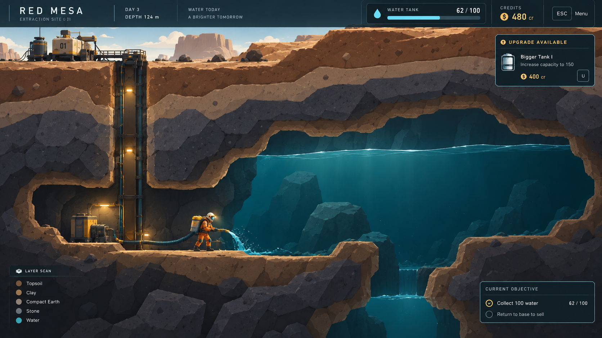

# Art Direction — Earned Capability

## Core identity

A weighty, stylized industrial cutaway with chunky illustrated forms, tangible equipment, restrained colors, and a quietly optimistic atmosphere.

The world is massive but not hostile. The worker is small but not fragile. Equipment feels practical, substantial, and satisfying to improve.

Water is the visual centerpiece. The player’s growing ability to handle it is the emotional centerpiece.

## Emotional target

Communicate a transformation from being under-equipped for an enormous task to becoming confidently capable of completing it:

“This is far beyond what I can handle right now.”
“I’m starting to make a real dent.”
“I remember when this was difficult.”

The starting character should feel like a competent worker with inadequate tools—not a helpless person trapped in an uncaring environment.

Express the scale of the challenge through the amount and physical mass of earth and water, not through threatening imagery or oppressive darkness. Preserve a sense that useful work is always possible.

## Visual language

Use a side-on 2D geological cross-section, illustrated with a sculpted, physical-model quality. This appearance does not require actual 3D.

Favor strong silhouettes, broad shapes, slightly exaggerated proportions, and controlled shading. Forms should feel substantial rather than flat, but clearly designed rather than realistically rendered.

Use large, readable facets and soft transitions between a small number of shading values. Avoid dense surface detail, noisy rock textures, photorealistic materials, and cinematic concept-art rendering.

The style should feel grounded and tactile—not cute, glossy, or toy-like.

## Terrain and underground spaces

Give the earth visible mass through broad geological bands, thick-looking cut edges, occasional large fractures, and clearly differentiated materials.

Material identity should come primarily from shape, value, and restrained pattern:
- Clay: smoother, softer masses.
- Stone: broader angular forms and deliberate fractures.
- Dense rock: heavier, more compact shapes.

Separate solid terrain, excavated space, and background rock clearly. Cave interiors should have enough ambient visibility to feel workable, without depending on constant bright lights.

Terrain must retain its visual quality after arbitrary player excavation. The style should work on newly exposed edges and awkward player-dug tunnels, not only on attractive predesigned caves.

## Water

Make water the most visually refined material in the scene.

Use controlled blue-teal color, readable depth, smooth surfaces, broad restrained highlights, and coherent flow shapes. It should feel like a substantial volume of liquid, not a luminous decorative effect.

Pools can remain calm while small ripples and surface movement keep them alive. Collection and drainage should visibly affect the water in satisfying, understandable ways.

Avoid neon cyan, magical glow, excessive sparkling particles, and exaggerated splashing. Water stands out through material contrast and movement, not overwhelming saturation.

## Character and equipment

Design a sturdy worker with a clear silhouette, purposeful posture, and a restrained warm workwear accent.

Equipment should resemble dependable industrial tools: understandable housings, substantial tanks, sturdy handles, and recognizable working parts. Avoid weapon-like silhouettes, ornamental steampunk detail, or excessive science-fiction complexity.

Major upgrades should be distinguishable at gameplay scale through changes in form, proportions, attachments, or operating motion—not only through HUD numbers.

These visual improvements should support the existing gameplay. Do not introduce elaborate factory infrastructure merely to communicate progression.

## Progression and motion

Express increasing power through ease, control, and visible results—not frenzy.

Early equipment accomplishes modest amounts with noticeable effort. Improved equipment performs more substantial work with cleaner, steadier actions.

Preserve visual evidence of achievement where possible: excavated passages, drained chambers, exposed formations, and recognizable landmarks.

Keep the world’s visual identity consistent across progression. Do not rely on changing an ugly, dark early game into a bright, colorful late game. The important transformation is the player’s ability to affect the world.

## Palette and lighting

Use a limited, subdued palette: warm mineral grays, dusty clay, muted ochre, charcoal metal, slate shadows, controlled teal water, and a small workwear-orange accent.

Establish hierarchy through value, shape, and material contrast rather than widespread saturation.

Lighting should be soft, readable, and quietly warm. Local work lights can suggest care and competence, but avoid oppressive blackness, dramatic horror lighting, heavy bloom, or exaggerated atmospheric haze.

## Interface

Use compact, contemporary industrial UI: clean sans-serif typography, restrained dark panels, thin borders, and selective amber or pale-cyan accents.

Keep essential information clear without covering the world. Avoid decorative gauges, unnecessary technical overlays, and elaborate science-fiction framing.

## Guiding principle

The world does not need to become brighter.
The player’s ability to affect it needs to become unmistakable.

## Generated reference image

Use the image to guide palette, weight, material separation, equipment forms, and interface treatment. The brief above defines the visual direction; [the demo scope](DEMO.md) defines the gameplay systems and HUD content.
